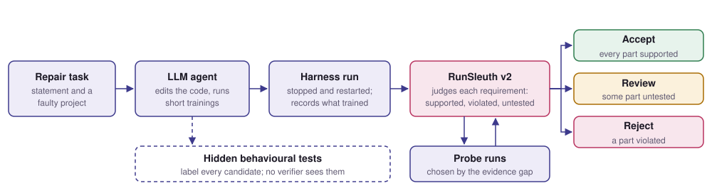
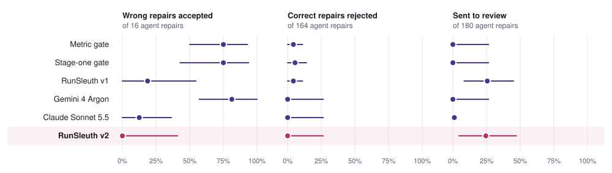

# RunSleuth: Evidence-grounded ML Training Failure Diagnosis and Repair Verification

[](https://github.com/Kaiden118/RunSleuth-Evidence-Grounded-ML-Training-Failure-Diagnosis-and-Repair-Verification/actions/workflows/ci.yml)


[](LICENSE)

RunSleuth decides whether to accept the repairs that LLM agents make to deep-learning
training code. Training faults are often silent: the run completes and accuracy barely
moves. RunSleuth judges each requirement of a task from evidence recorded while the
repaired project trains and from short probe runs, then accepts the repair, rejects it,
or sends it to human review. The requirements it checks are common to supervised
training; we evaluate it on medical image classification.

On a held-out test split of 180 repairs written by five LLM agents for six faults in
pathology (Camelyon17-WILDS) and dermoscopy (HAM10000) training pipelines, RunSleuth v2
accepted none of the 16 wrong repairs, rejected none of the 164 correct ones, and sent
44 to review. The strongest LLM reviewer accepted 2 of the wrong repairs and a
calibrated metric gate 12. The results are preliminary until the blind review of the
labels is complete.

<p align="center"></p>
<p align="center"><em>Figure 1. A repair is trained in a harness that may stop and restart it. RunSleuth v2
judges every requirement from the run's records and from probe runs chosen by what is
still untested. Hidden behavioural tests label the candidates; no verifier sees them.</em></p>

## Contents

| Component | Question | Status |
|---|---|---|
| [Repair verification](#repair-verification) | Can acceptance catch wrong agent repairs without rejecting correct ones written differently, at bounded cost? | Test split complete; blind review pending |
| [Agent study](#agent-study) | Does RunSleuth's evidence help LLM agents repair training scripts, or only catch their mistakes? | Complete; results in the report |
| [Diagnosis](#diagnosis-of-training-runs) | Can silent faults be diagnosed from a run's evidence, and repairs verified by retraining? | Complete |

## Installation

```bash
git clone https://github.com/Kaiden118/RunSleuth-Evidence-Grounded-ML-Training-Failure-Diagnosis-and-Repair-Verification.git
cd RunSleuth-Evidence-Grounded-ML-Training-Failure-Diagnosis-and-Repair-Verification
pip install torch==2.13.0 torchvision==0.28.0 --index-url https://download.pytorch.org/whl/cu130
pip install -e ".[dev,llm,hf,camelyon]"
```

Python 3.11. Diagnosis runs on CPU; training needs an NVIDIA GPU with 8 GB. A Docker
image is available: `docker build --target runtime -t runsleuth .`

## Repair Verification

### Benchmark

| | |
|---|---|
| Tasks | Six faults that show only at run time, in small training pipelines (`config.py`, `data.py`, `train.py`) that own their data, checkpoints and delivered weights: training-data filter, restart after a stop and delivered weights on Camelyon17-WILDS; restart after a stop, image cache and label mapping on HAM10000. Each task has a development case and a held-out test case. |
| Agents | Gemini 3.5 Flash-Lite, GPT-6.1 Sol, DeepSeek V4.1 Flash, Muse Spark 1.3 and Qwen3.8-27B, at provider defaults and under the same limits: 20 tool calls, 3 short runs, 32,000 output tokens. |
| Test candidates | 180 agent repairs: every agent starts from 12 versions (6 faults, 6 correct variants) on 3 seeds. Another 45 candidates (hand-written versions, partial repairs and runs with evidence removed) are reported apart. |
| Labels | Hidden behavioural tests: 182 candidates correct, 43 wrong, of which 16 are agent repairs. A blind review by two annotators audits the labels. |
| Protocol | Verifiers, hidden tests and analysis were frozen on 2026-10-23, before the first test candidate ([`freeze.json`](evaluations/freeze.json)); the test seeds were drawn afterwards. |

### Verifiers

| Verifier | Evidence | Decisions |
|---|---|---|
| Metric gate | Validation accuracy against the healthy run on the same seed; thresholds calibrated on correct runs | accept, reject |
| Stage-one gate | Validation accuracy and loss within fixed margins | accept, reject |
| RunSleuth v1 | Failure signatures and the metric gate | accept, review, reject |
| LLM reviewers | Task statement, code, diff and run records; Gemini 4 Argon and Claude Sonnet 5.5, from other vendors than the agents | accept, review, reject |
| RunSleuth v2 | Run records, then probe runs chosen by the evidence gap; a control runs the same probes in a fixed order | accept, review, reject |

### Results

*Table 1. Test results on the 180 agent repairs. Brackets give 95% intervals from a
bootstrap over the 12 starting versions.*

| Verifier | Wrong accepted | Correct rejected | Sent to review | Cost per candidate |
|---|---:|---:|---:|---|
| Metric gate | 12/16 [0.50, 0.93] | 7/164 | 0/180 | none beyond its run |
| Stage-one gate | 12/16 [0.43, 0.94] | 9/164 | 0/180 | none beyond its run |
| RunSleuth v1 | 3/16 [0.00, 0.55] | 7/164 | 46/180 | none beyond its run |
| Gemini 4 Argon | 13/16 [0.57, 1.00] | 0/164 | 0/180 | 14.2k + 1.0k tokens, 10 s |
| Claude Sonnet 5.5 | 2/16 [0.00, 0.36] | 0/164 | 2/180 | 17.9k + 3.7k tokens, 58 s |
| **RunSleuth v2** | **0/16 [0.00, 0.41]** | **0/164** | 44/180 | 2.6 probe runs, 152 GPU s |

<p align="center"></p>
<p align="center"><em>Figure 2. Rates on the agent repairs with 95% intervals. Where a verifier made no error
of a kind, the interval reaches the exact bound with the 12 starting versions as units.</em></p>

- **Order of checks.** In the fixed order, v2 made the same 225 decisions with 3.2 probe
  runs and 227 GPU seconds per candidate; choosing probes by the evidence gap saved a
  third of the GPU time and was never dearer. Combined with either reviewer by the rule
  fixed before testing, v2 decided as it did alone.
- **All candidates.** Over all 225 test candidates, v2 accepted 0 of 43 wrong and
  rejected 0 of 182 correct, sending 59 to review; Claude Sonnet 5.5 accepted 4 of the
  43 wrong and Gemini 4 Argon 31.
- **Reviews.** Every agent repair v2 sent to review was correct but did not train step
  by step as the reference did (for example, in another batch order), so several
  requirements stayed untested.
- **Reviewer stability.** Gemini 4 Argon rejected all 17 wrong development candidates
  but accepted 13 of the 16 wrong test repairs.

```bash
python -m runsleuth.freeze check
python -m runsleuth.candidates generate --split test --model-name <agent> --provider <provider>
python -m runsleuth.candidates run --split test
python -m runsleuth.candidates label --split test
python -m runsleuth.verifier_evaluation decide --split test
python -m runsleuth.verifier_evaluation review --split test --name <reviewer> --provider <provider>
python -m runsleuth.verifier_v2 verify --split test --order gap
python -m runsleuth.verifier_evaluation score --split test --reviewers gemini-4-argon claude-sonnet-5.5
```

Agent-edited code runs in a subprocess under a Python-level guard, not in a container.
The results cover two image classification pipelines with ResNet18, written for
RunSleuth's harness; other tasks, models and code structures are untested.

## Agent Study

| | |
|---|---|
| Question | When an agent says a training script is fixed, is it? Does RunSleuth's evidence help the agent, or catch it? |
| Tasks | 22 Camelyon17 scripts: 9 faults RunSleuth knows, 7 it does not, 5 correct scripts that look faulty, 1 healthy |
| Conditions | Code only, training runs, raw evidence, diagnosis, a verdict on the agent's own runs |
| Models | Gemini 3.5 Flash-Lite and GPT-6 Luna, 550 episodes each |
| Labels | Hidden contract tests written from the task statement |

The study was frozen on 2026-10-13, before the first episode. Every episode has run;
its results will appear in the report.

## Diagnosis of Training Runs

<p align="center"></p>
<p align="center"><em>Figure 3. A recorded run is matched against failure signatures, compared with a healthy
reference run, and a repair is accepted only after retraining verifies it.</em></p>

*Table 2. Faults and the evidence that decides them.*

| Fault | Decisive evidence |
|---|---|
| Stale optimizer binding | The new head gets gradients but never updates |
| Frozen classifier head\* | The head is untrainable; the reference trains it |
| Learning rate far too high | Rate inferred from AdamW's first update |
| Missing `optimizer.step()` | Gradients exist, no parameter changes |
| Train/eval normalization mismatch | Training and evaluation inputs differ |
| Head larger than the label set | 1000 outputs for 2 classes |
| Partly frozen backbone\* | Some backbone tensors never get gradients |
| Training in eval mode\* | Steps train on eval-mode forwards |
| Per-epoch schedule stepped every batch\* | The rate falls and rises within an epoch |

\*Confirmed only with a healthy reference run; without one, RunSleuth defers. Two
further signatures, training on a held-out group and an epoch at zero learning rate,
were checked on one development seed only.

*Table 3. Diagnosis on Camelyon17-WILDS with ResNet18 and DeiT-small (Hugging Face).
Held-out seeds were drawn after signatures, prompt and thresholds were frozen.*

| | Development | Held-out |
|---|---:|---:|
| Correct diagnosis, given a healthy reference | 56/56 | 42/42 |
| Without a reference: correct · deferred · wrong | 46 · 10 · 0 | 34 · 8 · 0 |
| False positives on healthy runs | 0/32 | 0/24 |
| Repairs accepted after retraining | 18/18 | 19/20 |

In 11 of 38 faulty runs, validation metrics stayed within the thresholds of the healthy
run. Faults were injected by the author; the numbers come from the
[records](evaluations/results).

**Example.** A ResNet18 whose classification head was frozen by mistake reaches 98.2%
validation accuracy, above the healthy run's 97.9%. Its metrics pass every check; its
evidence does not (output shortened):

```bash
runsleuth diagnose --run examples/frozen_head/run_report.json --reference examples/clean/run_report.json --no-llm
runsleuth verify --candidate examples/frozen_head/run_report.json --reference examples/clean/run_report.json
```

```text
Diagnosis: frozen_head  (decided by signature_matcher)
Evidence:
  + head_max_gradient_fraction = 0.0 (== 0)
  + head_max_update_norm = 0.0 (== 0)
  + reference_head_min_trainable_fraction = 1.0 (== 1)
Decision: rejected
No regression against the reference:
  + id accuracy_drop = -0.003 (<= 0.01)
  + ood accuracy_drop = 0.005 (<= 0.01)
Reason: re-diagnosis against the reference found frozen_head
```

Runs are recorded with `runsleuth.run_monitor.RunMonitor`, or with
`runsleuth.hf_callback.RunSleuthCallback` for the Hugging Face `Trainer`. An optional
LLM explanation must cite the evidence and cannot change the diagnosis.

To reproduce Table 3, set `data_dir` in
[`configs/camelyon17_clean.json`](configs/camelyon17_clean.json) (about 20 GB); names
in angle brackets are run directories printed by earlier commands.

```bash
python -m runsleuth.camelyon --download --prepare-only
python -m runsleuth.camelyon
python -m runsleuth.camelyon_optimizer_sweep --reference-run <baseline-run> --execute
python -m runsleuth.camelyon_frozen_head_training --reference-run <seed-baseline-run>
python -m runsleuth.camelyon_config_faults --reference-run <seed-baseline-run>
python -c "from transformers import AutoModelForImageClassification as M; M.from_pretrained('facebook/deit-small-patch16-224')"
python -m runsleuth.camelyon_vit --reference-run <seed-baseline-run>
python -m runsleuth.camelyon_loop_faults --reference-run <seed-baseline-run>
python -m runsleuth.heldout draw --count 2
python -m runsleuth.heldout run --reference-run <baseline-run>
```

## Roadmap

| Stage                                                         | Status |
| ------------------------------------------------------------- | :----: |
| Training monitor, nine faults, ResNet18 and DeiT              |   ☑    |
| Repair verification, held-out seeds, LLM explanation          |   ☑    |
| Command line, Hugging Face callback, CI, Docker               |   ☑    |
| Agent study: 22 tasks, 5 conditions, 2 LLMs                   |   ☑    |
| Pipeline harness, hidden tests, six run-time tasks            |   ☑    |
| Baselines and RunSleuth v2 on development cases, then freeze  |   ☑    |
| Test repairs from five LLM agents, all verifiers              |   ☑    |
| Blind review of the labels                                    |   ☐    |
| Report and release                                            |   ☐    |

☑ done · ☐ planned

## Tests and License

`python -m pytest` runs every test on CPU with tiny models and synthetic data;
[GitHub Actions](.github/workflows/ci.yml) runs it on every push and inside the
[Docker image](Dockerfile). The code is released under the [MIT License](LICENSE);
datasets and pretrained weights keep their own licenses.
